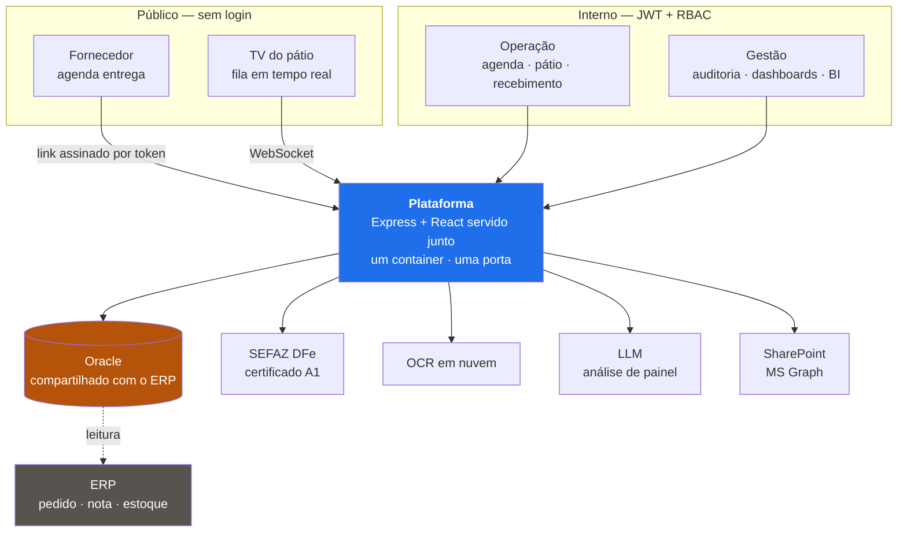
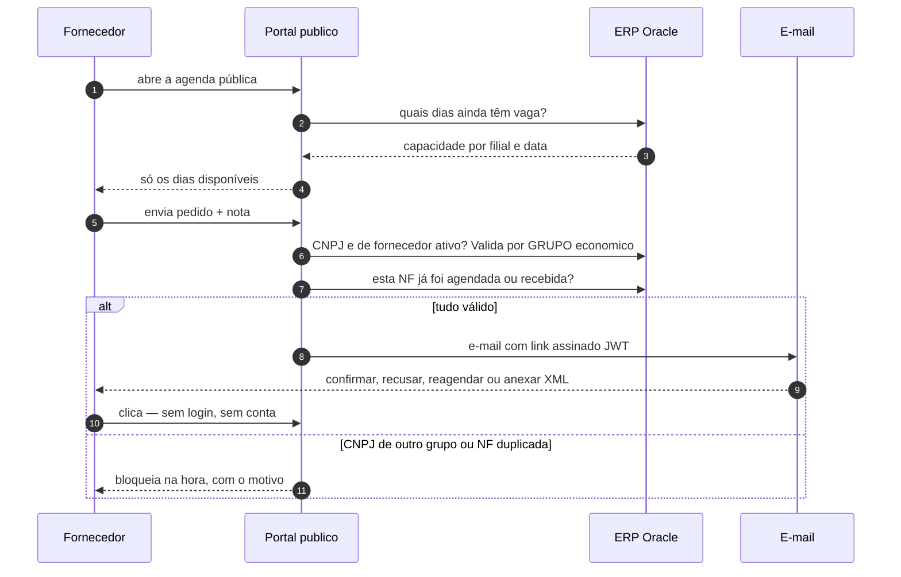
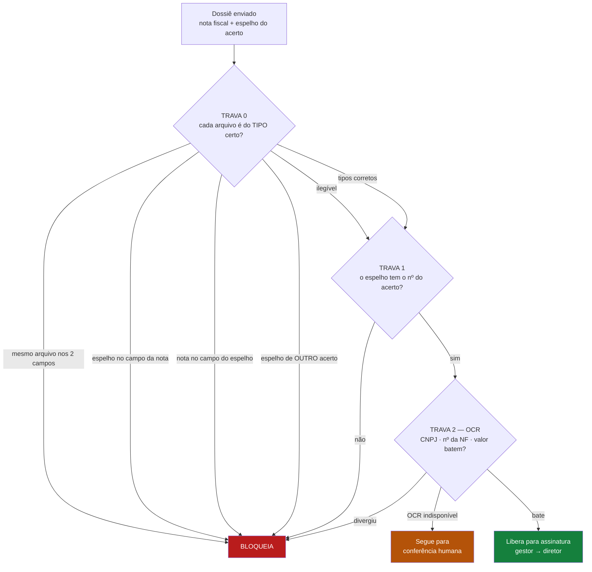
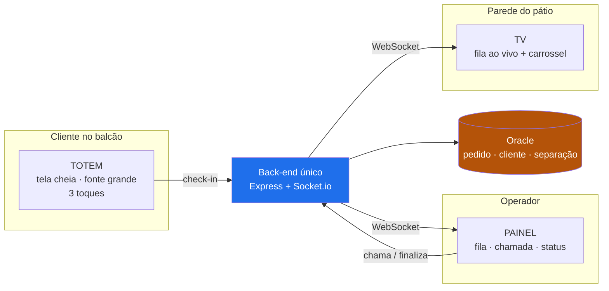
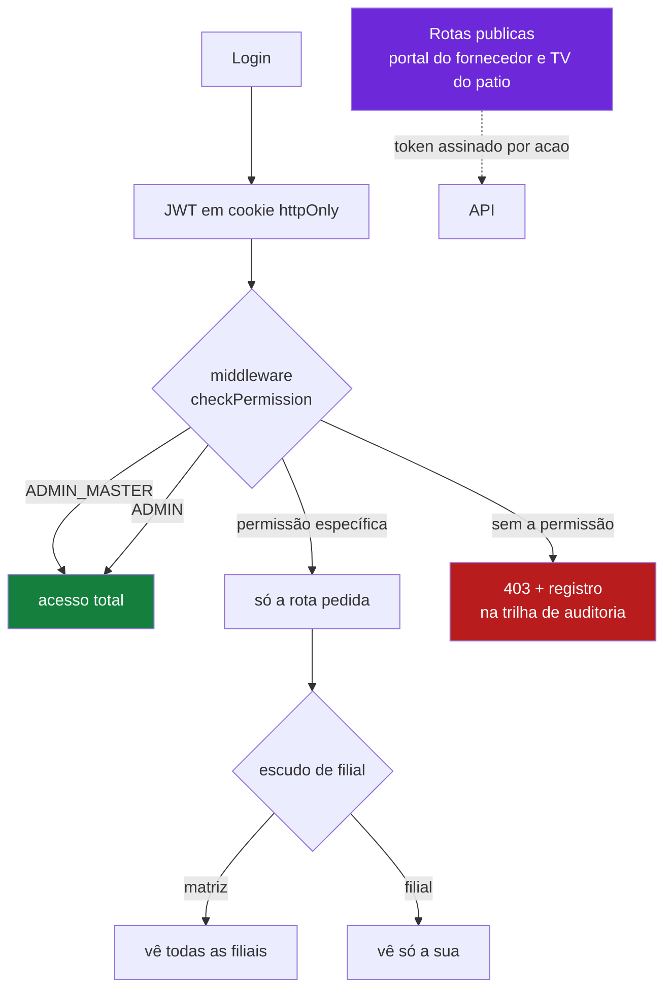

# Plataforma Logística — estudo de caso

> Como uma rede de atacado da construção trocou planilha, telefone e WhatsApp por
> uma plataforma de 13 módulos em produção — construída por **um desenvolvedor**.

Este repositório **não tem código**: o sistema é proprietário. O que tem aqui é a
arquitetura, as decisões técnicas e o que eu faria diferente — nos diagramas abaixo,
que descrevem o sistema real em produção.

**Sobre mim:** Lucas Novais · [LinkedIn](https://linkedin.com/in/lucas-novais) ·
Node.js · React · Oracle · Docker

---

## Os números

| | |
|---|---|
| Módulos em produção | **13** |
| Commits · autores | **539 · 1** |
| Usuários internos | **101** |
| Fornecedores no portal público | **347 CNPJs** · 190 grupos econômicos |
| Agendamentos processados | **3.700** |
| Dossiês de frete auditados | **1.652** |
| Valor de frete auditado pela plataforma | **R$ 11,5 milhões** |

E o que mudou na operação:

| Processo | Antes | Depois |
|---|---|---|
| Ciclo completo de um acerto de frete | 4 horas | **25 min** |
| Descobrir status/previsão de uma carga | 60 min de telefonema | **1 min** |
| Entregar o dossiê ao financeiro | 2 horas | **deixou de existir** |
| Reagendar uma entrega | 20 min | **4 min** |

Esses números não são estimativa: eu construí um módulo de telemetria justamente
para medi-los.

---

**O que tem aqui:**
[O problema](#o-problema) ·
[Arquitetura](#arquitetura) ·
[O fornecedor nunca cria conta](#1-o-fornecedor-nunca-cria-conta) ·
[A validação que confere o tipo](#2-a-validação-que-confere-o-tipo-antes-do-conteúdo) ·
[Três interfaces, um back-end](#3-três-interfaces-um-back-end) ·
[Segurança](#4-segurança-para-público-interno-e-externo-no-mesmo-processo) ·
[Decisões que eu tomaria de novo](#decisões-que-eu-tomaria-de-novo) ·
[Trocar o processo sem parar a operação](#trocar-o-processo-sem-parar-a-operação) ·
[O que eu faria diferente](#o-que-eu-faria-diferente)

---

## O problema

Uma rede de atacado recebe carga o dia inteiro, todo dia, sem janela de manutenção.

Antes, agendar uma entrega era telefone, WhatsApp e uma planilha compartilhada.
O fornecedor ligava, alguém anotava, alguém esquecia — e o caminhão chegava sem vaga
e ficava parado no pátio. O pagamento das transportadoras era conferido documento por
documento, à mão. Saber onde estava uma carga era uma ligação de uma hora.

Nada disso era falta de competência. Era falta de sistema — e a empresa não é de
tecnologia.

---

## Arquitetura

**A decisão que sustenta tudo:** uma aplicação, um container, um domínio.
O React é compilado no build e servido pelo próprio Express. O portal público dos
fornecedores e o sistema interno são o **mesmo processo**, separados por rota e
permissão.

Isso me custou disciplina de RBAC e ganhou: sem CORS para depurar, sem cookie de
terceiro, sem segundo deploy para esquecer, sem certificado extra. Para um time de
uma pessoa, cada peça a menos é uma peça que não quebra às 22h de sábado.

---

## Quatro coisas que valem ser vistas

### 1. O fornecedor nunca cria conta

O fornecedor abre uma página pública, escolhe um dia entre os que **ainda têm vaga**,
e envia. O sistema valida contra o ERP na hora: o CNPJ é de um fornecedor ativo? —
e valida por **grupo econômico**, não por CNPJ exato, porque existe fornecedor com
duas raízes diferentes no mesmo cadastro. Essa nota já foi agendada? Já foi recebida?

Aprovado, ele recebe um e-mail com um **link assinado com JWT**. Clica e confirma,
recusa, reagenda ou anexa o XML da nota.

Sem conta. Sem senha. Sem canal de suporte novo.

O detalhe que eu mais gosto é o que o e-mail **não** faz: ele não pede para "acessar
o portal e verificar". Ele mostra o pedido, a nota, a data e dois botões. Resolve no
celular, na rua, em oito segundos.

> **347 CNPJs de fornecedores usam. Zero cadastros criados.**

### 2. A validação que confere o tipo antes do conteúdo

> **A trava 0 nasceu de um erro meu.** O cruzamento original procurava o número da
> nota *dentro* do arquivo da nota — mas o espelho também imprime `Nota fiscal: N`.
> Então o espelho, posto no campo errado, se auto-validava. A verificação estava
> correta; a premissa é que estava errada.
>
> E repare no caminho laranja: **documento ilegível não bloqueia**. Nota de serviço
> municipal embaralha o texto ao extrair, e um sistema que barra o documento certo é
> abandonado em duas semanas.

Para pagar uma transportadora, alguém monta um dossiê: nota fiscal do serviço +
espelho do acerto + romaneios. Um gestor assina, um diretor assina, o dinheiro sai.
Era 100% conferência humana.

Automatizei com OCR, cruzando CNPJ, número da nota e valor. Funcionou por meses — até
um dossiê passar com o **espelho nos dois campos**, sem nota fiscal nenhuma.

O motivo é sutil: meu cruzamento procurava o número da nota *dentro* do arquivo da
nota. Mas o espelho também imprime `Nota fiscal: N` no corpo. Então o espelho, posto
no campo da nota, **se auto-validava**.

A verificação estava correta. A premissa é que estava errada — eu conferia o
**conteúdo** sem nunca ter conferido o **tipo**.

Hoje uma trava roda antes de qualquer OCR pesado e classifica cada arquivo pelo que
ele é. E uma decisão que eu defendo: **documento ilegível não bloqueia**. Nota de
serviço municipal embaralha o texto ao extrair; bloquear por ausência de marcador
barraria nota legítima todo dia — e um sistema que barra o documento certo é
abandonado em duas semanas.

### 3. Três interfaces, um back-end

> Três públicos com necessidades opostas, um back-end só. O cliente não quer aprender
> um sistema — quer saber se pode entrar. O operador quer a fila. Quem está esperando
> quer saber se é a vez dele sem precisar perguntar.

O cliente que vem retirar mercadoria não usa o mesmo sistema do operador. Ele usa um
**totem**: tela cheia, fonte grande, três toques. O operador usa um **painel**. E na
parede tem uma **TV** com a fila em tempo real por WebSocket, para ninguém precisar
perguntar "sou eu agora?".

Meu usuário mais difícil tem 58 anos, opera o mesmo sistema há 20 e não vai ler
manual nenhum. E ele está certo: ele quer terminar o trabalho e ir para casa.

Por isso, quando alguém loga, não cai num menu — cai direto no único módulo que a
permissão dele libera. Menu é uma pergunta, e pergunta custa tempo de quem tem fila
esperando.

### 4. Segurança para público interno e externo no mesmo processo

> **30+ permissões granulares, três níveis de privilégio.** Ter público externo e
> interno no mesmo processo significa que RBAC não é enfeite: é o que separa um
> fornecedor de ver o dado de outro fornecedor.

**30+ permissões granulares**, três níveis de privilégio, escudo de filial e trilha
de auditoria de acesso. JWT em cookie `httpOnly`, CSP, sanitização XSS recursiva,
rate limiting, certificado digital fora do versionamento.

Ter público externo no mesmo domínio significa que RBAC não é enfeite: é o que separa
um fornecedor de ver o dado de outro fornecedor.

---

## Decisões que eu tomaria de novo

**O pool do banco tem teto baixo de propósito.** O Oracle é o mesmo do ERP da empresa.
Inflar o pool consome sessões do banco e pode estourar o limite de `processes` — o que
não derruba o meu sistema, derruba o faturamento.

Depois de um incidente de contenção de lock em produção, a correção **não** foi
aumentar o pool. Foi `FOR UPDATE NOWAIT` (falha rápido em 409 em vez de enfileirar),
anti-double-submit no front (a causa raiz era comportamento humano) e um timeout de
chamada como rede para o próximo bug, que eu ainda não conheço.

Quando você divide infraestrutura com o que sustenta o negócio, a decisão certa quase
nunca é a que resolve o seu problema mais rápido. É a que não transfere o problema
para o vizinho.

**Integração externa degrada, não quebra.** Sem chave de OCR, a validação devolve
"indisponível" e o fluxo segue pela conferência humana. Sem chave de LLM, o painel
oferece copiar o resumo. Sem certificado, o robô fiscal não inicia. Nenhuma
dependência externa derruba a aplicação.

**Medir faz parte de entregar.** Construí um módulo só para medir adoção real por
módulo e tempo de processo antes × depois. Entrega que ninguém consegue provar vira
"custo de TI" na próxima reunião de orçamento.

---

## Trocar o processo sem parar a operação

A parte difícil nunca foi o código. Foi o corte.

A empresa recebe carga o dia inteiro, todo dia. **Não existe janela de manutenção** —
não dá pra "parar o recebimento no sábado pra migrar". E do outro lado tem gente que
faz aquilo do mesmo jeito há vinte anos, com razão: o jeito antigo funciona.

O que aprendi a fazer, em todo módulo:

**Rodar em paralelo antes de substituir.** O sistema novo convive com a planilha por
algumas semanas. Ninguém é obrigado a nada. Quando o novo já tem mais informação que o
antigo, a troca acontece sozinha — as pessoas migram porque é melhor, não porque
mandaram.

**Cortar por filial, não por data.** Uma filial inteira de cada vez, começando pela
menor. Se der errado, o estrago é pequeno e reversível, e as outras cinco seguem
operando.

**Mostrar o caso mais chato da pessoa funcionando.** Enquanto quem opera não vir a
própria exceção resolvida na tela, ela não migra — e está certa. Vinte minutos
sentado ao lado dela valem mais que qualquer treinamento em sala.

**Medir antes.** Cronometrar o processo antigo parece burocracia até o dia em que
alguém pergunta se valeu a pena. Sem o número de antes, a resposta vira opinião.

O resultado é que nenhuma das substituições gerou parada de operação ou retrabalho —
e é por isso que entrou módulo novo treze vezes seguidas, em vez de parar no segundo.

---

## O que eu faria diferente

- **Testes desde o início.** Não tem suíte automatizada. Com uma pessoa e prazo de
  operação, a escolha foi consciente — mas é a primeira dívida que eu pagaria.
- **DDL versionada desde o commit 1.** Comecei a versionar schema tarde, e as tabelas
  mais antigas ficaram só dentro do banco. Extraí e versionei depois; deveria ter
  nascido assim.
- **Observabilidade além de log em arquivo.** Funciona, mas investigar incidente
  ainda depende de `grep`.

---

## Stack

`Node.js 20` `Express 5` `React 19` `Vite` `Oracle 21` `PL/SQL` `Socket.io`
`Docker` `Nginx` `JWT` `SEFAZ NF-e/DFe` `Microsoft Graph` `Azure Vision` `LLM`

---

  Dúvida sobre alguma decisão daqui? Chama no
  <a href="https://linkedin.com/in/lucas-novais">LinkedIn</a> — respondo todas.

